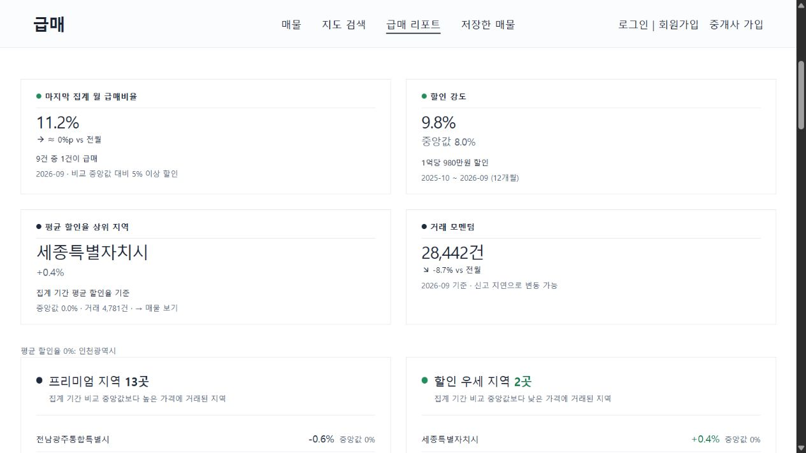

# P1 급매 리포트 집계 수정

2026-10-13. 운영 계정 연결을 기다리는 매물 보안 적용과 별도로 리포트 집계와 공개 번들을 수정했다. 최초 검증은 로컬에서 완료했으며, 이후 사용자의 운영 배포 요청에 따라 기존 `origin/main`에서 리포트 수정만 분리했다. Supabase 마이그레이션·Edge Function·매물 쓰기 경로 변경은 이번 배포에 포함하지 않는다. 운영 DB에는 쓰지 않는다.

## 수정 내용

- 비교 기준을 단지명·면적 구간에서 전체 법정동 주소·단지명·아파트 일련번호(없으면 지번, 그마저 없으면 건축년도)·정확한 전용면적으로 변경했다. 다른 지역의 동명 단지와 84.91㎡/84.99㎡가 섞이지 않는다.
- 지역·월별·면적대·단지 순위·요약 모두 같은 12개월을 사용한다. 일반 CSV의 마지막 거래월 또는 API 수집 완료 기록의 마지막 월이 기준이다. 이번 API 경로는 지난달까지의 12개월을 받는다. 전체 입력 기간 거래량은 `full_period`로 별도 보관한다.
- 해제 거래와 직거래, 잘못된 금액·면적·월을 제외한다. 거래유형 미상은 포함하되 건수를 공개한다. 비교 표본 3건 미만은 할인율 `null`로 남기고 판정 불가 건수를 표시한다.
- 급매비율은 비교 중앙값 대비 5% 이상 낮은 거래 수 / 전체 유효 거래 수다. 표본 부족 거래도 분모에 포함한다. 기간 전체를 사후 비교하며 대상 거래도 중앙값에 포함한다. 층수는 보정하지 않는다. 등록 매물의 개별 가격 판정과 같은 지표가 아님을 화면에 설명한다.
- 급매 집중 단지는 지역별로 분리하고 10건 이상 표본 조건을 적용한 뒤 순위를 자른다. 화면과 AI 입력이 같은 함수를 사용한다.
- 월별 마지막 점을 무조건 미완료 월로 분류하던 표시와 마지막 달을 빼고 1년 평균이라고 부르던 계산을 제거했다. 모든 월은 추후 신고·해제로 변할 수 있음을 표시한다.
- 새 집계 버전·연속된 12개월·지역/월/면적 합계가 맞아야 화면에 표시한다. AI 요약은 집계 식별값과 기간이 일치해야 표시한다. 기존 AI 파일은 삭제하지 않고 표시를 중단했으며, 새 AI 생성기는 같은 기준으로 입력을 만든다.
- DB용 시장 스냅샷 SQL 생성기도 같은 변환 함수를 사용한다. 임의로 고정했던 홈 추이 숫자를 제거했다.

## API 원본 경로와 지역 코드 누락

기존 `fetch-trades.py`와 `.env.local`의 국토부 API 키로 실제 조회가 가능했다. CSV를 사용자에게 별도로 요청할 필요가 없었다.

기존 정적 지역표로 수집하면 광주·전남의 모든 요청은 정상 응답 코드와 0건을 반환했다. 국토부 공개 사이트의 현재 시도 목록에는 전남광주통합특별시(12)가 있고, 인천 시군구 목록에도 검단구·영종구·제물포구 등 변경이 반영돼 있었다. 새 코드로 광산구의 2025-10 및 2026-09 과거 거래, 목포시·검단구·영종구 거래가 정상 반환되는 것을 확인했다. 단순 API 장애로 단정하면 안 되는 사례다.

출처: [국토부 실거래가 공개시스템 지역 선택](https://rt.molit.go.kr/pt/gis/gis.do?mobileAt=&srhThingSecd=A), [국토부 지역 선택 코드](https://rt.molit.go.kr/js/pt/gis/gisSearchBar.js), [국토부 전자계약 공지 목록의 2026-07-09 행정체계 개편 안내](https://irts.molit.go.kr/usr/brd/bscbrd/bbs/RtecsBoardList.do?bbsId=BBSMSTR_000000000001).

새 `fetch-report-trades.py`는 이 공식 시도/시군구 목록을 읽어 수집한다. 페이지별 총 건수, 모든 시군구·월 요청 완료, 시도별 각 월에 데이터가 존재하는지 확인한다. 실패하면 기존 원본과 번들을 보존한다. 완료 기록에는 수집 기간·건수·지역·원본 SHA-256을 저장하고, 집계 전에 원본 일치 여부를 검사한다. 원본 CSV는 `scripts/data/report/`에만 두며 Git에서 제외한다.

기존 3년 시세 수집기와 Storage 원본의 지역 코드·파일명 전환은 다음 P1 데이터 갱신 작업에서 처리할 항목이다. 여기서는 그 원본을 덮어쓰지 않고 리포트용 경로를 별도로 사용했다. 기존 Actions를 그대로 실행하면 새 리포트 전용 수집 경로가 자동 실행되는 것은 아니다.

## 재실행

Node 22.12 이상과 Python 3.11 이상이 준비된 환경에서 `npm run report:refresh`. `.env.local`의 `MOLIT_API_KEY`를 사용하며 키와 수집 원본은 Git에 포함하지 않는다.

이미 받은 원본으로 재계산만 할 때:

```text
node scripts/import-trades-csv.mjs --report-input
node scripts/build-public-bundles.mjs --market-only
```

DB 적용용 SQL은 `node scripts/build-market-snapshots-seed-sql.mjs`로 만들 수 있다. 현재 웹 리포트는 번들을 읽으므로 DB 계정 연결 없이 검증할 수 있다.

새 AI 요약은 필요할 때 `node scripts/generate-market-report.mjs`로 별도 생성한다. 이 명령은 생성형 AI API를 호출한다. 이번 수정 검증에서는 호출하지 않는다.

## 검증

- Node 전체 테스트 204개 통과. 동명 단지/면적/기간 경계/제외 거래/표본 부족/순위/인코딩/합계/AI 식별값 회귀 테스트 11개 포함.
- Python 수집기 테스트 4개 통과. 현재 지역 목록 파싱, 단지 식별값 보존, API 오류, 페이지 누락·건수 변동을 확인한다.
- Vite 빌드 통과. 기존 큰 번들 경고는 별도 최적화 항목으로 남아 있다.
- 새 집계 전 브라우저에서 이전 버전 통계와 AI 설명이 노출되지 않고 재집계 안내가 나오는 것을 확인했다.


## 실제 재집계 결과

- 수집: 현재 지역표의 256개 시군구 × 12개월 = 3,072개 조회 단위 완료. 실패 0, 시도·월 누락 0.
- 기간: 2025-10 ~ 2026-09. 수집 시점 행정구역 기준 16개 시도.
- 원본 544,651건 → 해제 24,011건·직거래 39,064건 제외 → 집계 481,576건.
- 판정 가능 435,975건, 표본 부족 45,601건, 급매 분류 76,782건. 거래유형 미상 및 단지 식별정보 대체 건수 모두 0.
- 원본 CSV를 별도 Python 계산으로 다시 읽어 거래량·급매 건수·판정 가능 건수가 JS 산출물과 일치함을 확인했다. 지역·월·면적 거래량 합계도 각각 481,576건이다.
- 브라우저에서 12개월 기간, 거래량, 표본 안내 펼치기, 인천의 중립 분류, 현재 행정구역 명칭, 단지 10곳, 레이더의 급매비율·중앙값 탭 전환을 확인했다. 콘솔 오류·경고 없음. 이전 AI 설명은 표시되지 않는다.
- 최종 코드와 실제 번들로 Node 테스트 204개, Python 테스트 4개, 빌드 모두 통과했다.



## 운영 배포 구성 검증

- 기존 `origin/main`의 `1ef45645507bbb8f75e7822dfba33cd6c0bf086c`에서 리포트 관련 코드·번들·테스트·문서만 분리했다.
- 이 배포 구성으로 `npm ci`, Node 테스트 193개, Python 수집기 테스트 4개, 프로덕션 빌드가 모두 통과했다. 앞선 로컬 204개에는 이번에 제외한 매물 보안 테스트 11개가 포함돼 있다.
- 운영 Vercel에 설정된 환경변수는 기존 Git 연동 빌드에서 사용한다. 로컬 환경변수나 원본 CSV는 배포 커밋에 포함하지 않는다.
- Supabase 보안 마이그레이션과 매물 쓰기 기능 배포는 실제 운영 계정 연결 후 별도로 진행한다.
