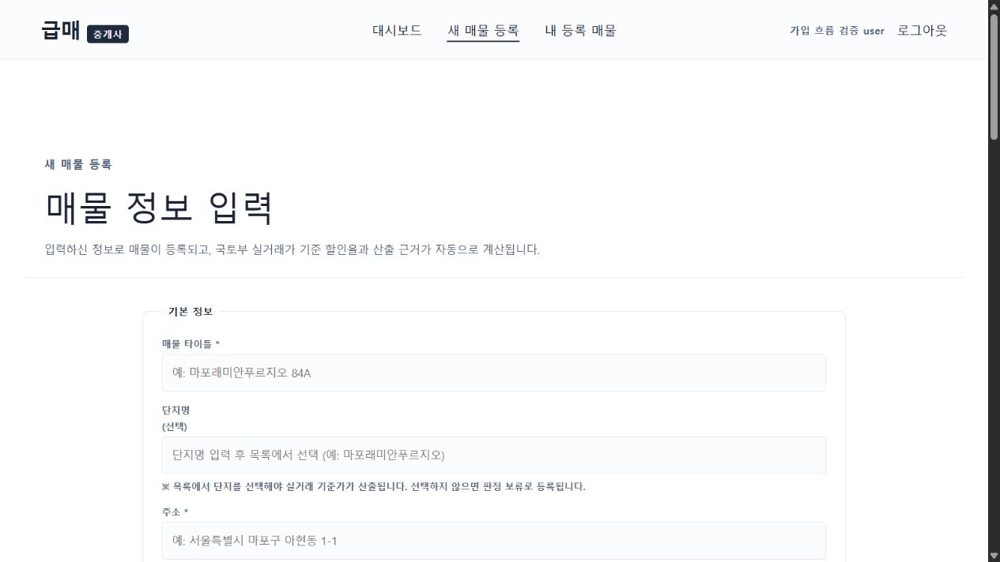

# 중개사 가입·승인 흐름 보완

대상: `jun030426/guepmae`, Supabase `oormfipegcfbhvctikfl`.

## 수정 내용

- 이메일 인증을 완료한 계정만 신청서와 서류를 제출한다. 인증 전 익명 업로드와 직접 신청서 INSERT를 차단했다.
- 신청서 소유자는 인증된 사용자 ID로 저장한다. 브라우저가 보낸 이메일이나 승인 상태를 신뢰하지 않는다.
- 서류는 비공개 버킷의 본인 계정 경로에 저장한다. 본인과 운영진만 열람할 수 있고, 접수된 서류는 신청자가 삭제할 수 없다.
- 운영 승인 시 신청 상태와 중개사 권한을 한 DB 트랜잭션에서 변경한다. 실패 시 두 변경 모두 취소된다.
- 중복 신청, 재시도 중 응답 유실, 업로드 일부 실패를 처리한다. 반려 후에는 다시 신청할 수 있다.
- 승인 대기 화면에서 상태를 새로고침하면 재로그인 없이 등록 화면으로 이동한다. 조회 오류를 미신청 상태로 표시하지 않는다.
- 프로젝트 범위 지침을 `AGENTS.md`에 기록했다.

## 검증

- Node 테스트 231개 통과. 새 SQL 권한·승인 테스트 9개와 업로드 복구 테스트 5개 포함.
- 프로덕션 빌드 성공. 기존 청크 크기 안내는 남아 있다.
- 마이그레이션 `20261015072558_secure_agent_onboarding.sql`을 급매 운영 DB에 적용했다. 보안 Advisor 경고는 적용 전후 동일하며 새 경고는 없다.
- 합성 자료와 임시 계정으로 브라우저 신청 → 비공개 서류 2개 업로드 → 대기 상태 → 운영진 RPC 승인 → 상태 새로고침 → 새 매물 등록 화면 진입을 확인했다.
- 실제 Storage에서 운영진의 두 서류 열람 성공과 비로그인 접근 거부를 확인했다.
- 실제 사용자 메일함의 가입 인증 메일 수신은 이번 검증에 포함하지 않았다. 이메일 인증이 완료된 임시 계정으로 신청 이후를 검증했다.
- 코드 커밋 `ab1e465`를 GitHub main에 푸시하고 Vercel 배포 성공을 확인했다. 운영 사이트에서 승인 계정 로그인과 새 매물 등록 화면 진입을 다시 확인했으며 브라우저 오류는 없었다.
- 임시 계정·신청서·첨부 서류를 제거했다. 기존 계정의 역할·정지 상태 및 신청서 수가 검증 전과 같은 것을 확인했다.
- 기본 작업 폴더에도 변경을 반영했다. 그 폴더의 이전 미커밋 변경은 유지했다.

## 후속 작업

- 실제 계정의 메일 수신·인증과 실물 서류 검토는 사용자의 첫 가입 시 확인한다. 자격 확인과 승인 판단은 운영자가 수행한다.
- 세경3차 매물 등록을 위한 사진 업로드 오류 처리, 360 사진만 있는 매물의 대표 이미지, 실제 Insta360 파일의 변환·투어를 다음 순서로 검증한다.
- 매물 등록 이후 공개 노출·수정·문의까지의 전체 실매물 과정은 아직 완료 판정을 내리지 않는다.
